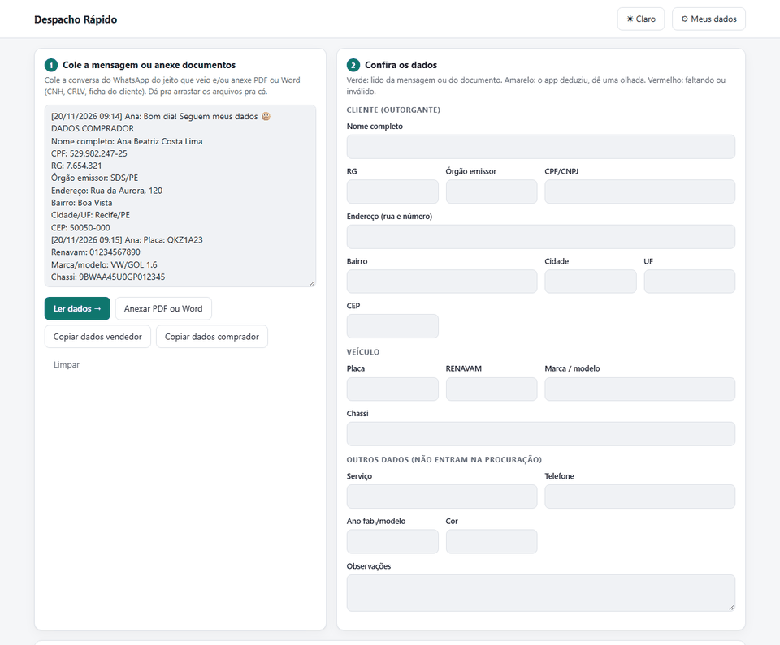
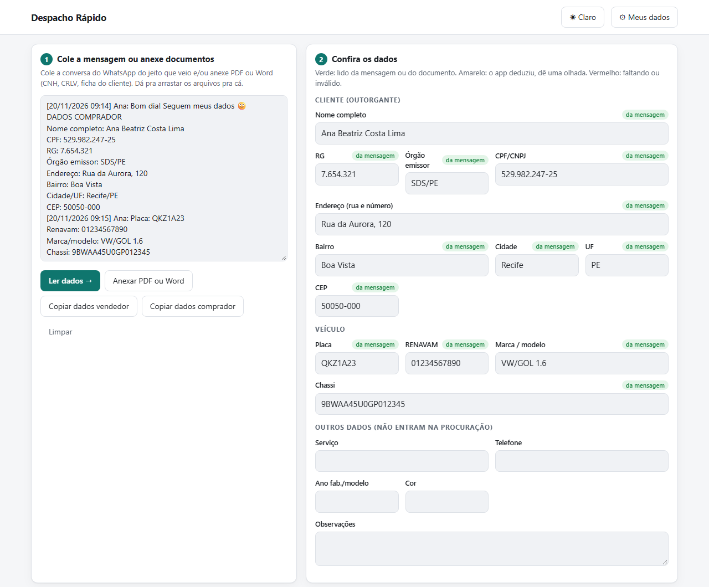
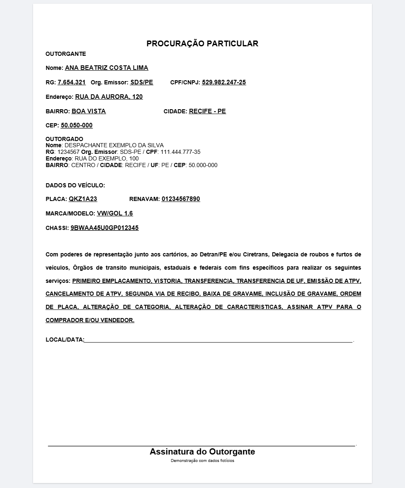

# Despacho Rápido

**Da mensagem do WhatsApp à procuração pronta pra assinar no gov.br, em segundos.**

Feito pra um despachante de verdade, que já usa no dia a dia.

[**Abrir o app**](https://felipe1072-git.github.io/despacho-rapido/) · [**Ver demonstração**](https://felipe1072-git.github.io/despacho-rapido/?demo=pdf) (dados fictícios)

## O problema

Um despachante recebe os pedidos pelo WhatsApp: nome, CPF, RG, endereço, dados do carro. Às vezes vêm em texto, às vezes em PDF (CNH digital, CRLV, ATPV-e, nota fiscal).

Pra cada cliente, ele copiava os dados à mão num modelo do Word, gerava o PDF e mandava assinar no gov.br. Era lento, dava erro de digitação e às vezes o documento dava problema na assinatura.

## A solução

Um app que roda no navegador (e instala no PC como programa):

1. **Cola a mensagem e/ou anexa os documentos.** O app tira os dados sozinho.
2. **Confere.** Cada campo vem marcado: 🟢 lido da mensagem ou do documento, 🟡 vale conferir, 🔴 faltando ou inválido (o CPF, por exemplo, é validado).
3. **Gera a procuração** no layout do modelo do despachante, sempre igual, pronta pra assinar.

| Conferência dos dados | Procuração gerada |
|---|---|
|  |  |

## Resultado

- Em uso pelo despachante no dia a dia, instalado no computador dele.
- PDF gerado aceito na assinatura eletrônica do gov.br.
- Nenhum dado de cliente sai do computador: tudo é processado no navegador.

## O que ele lê

| Fonte | Como lê | O que tira |
|---|---|---|
| Mensagem do WhatsApp | Regras (regex), sem IA: previsível e sem custo | Tudo que vier com ou sem rótulo, até mensagem bagunçada |
| **CNH digital** (PDF do gov.br) | O cartão é uma **imagem** dentro do PDF → OCR (tesseract.js) em recortes de posição fixa, conferido com a zona de leitura automática do rodapé | Nome, CPF, RG e órgão emissor |
| **ATPV-e** | Rótulo e valor pela posição no PDF, separando as seções de vendedor e comprador | Comprador + veículo; marca "transferência" |
| **CRLV-e** | Rótulo e valor pela posição; ignora o texto vertical do QR Code | Veículo e dono atual |
| **NF-e (DANFE)** | Seção do destinatário + busca por palavra-chave na descrição do produto (cada loja escreve de um jeito) | Comprador, chassi, modelo, cor, ano; marca "primeiro emplacamento" |
| **Word (.docx)** | Texto e tabelas | Fichas do tipo "Nome: …" |

Os botões **Copiar dados vendedor** e **Copiar dados comprador** copiam um pedido de dados pronto pro WhatsApp. A pessoa preenche e devolve, e a resposta é lida sem erro.

### Detalhes que só apareceram testando com documentos reais

- A CNH digital do gov.br não tem texto: o cartão inteiro é uma imagem. Daí o OCR.
- No CRLV, o texto vertical "Valide este QRCode" ficava bem embaixo do rótulo "NOME" e virava o nome do dono.
- A NF-e de veículo tem um "RENAVAM:001144" na descrição que é o código do modelo, não o RENAVAM do carro.
- Nos ATPV-e e NF-e há vários "NOME" e "ENDEREÇO" (vendedor, transportadora, emitente): o app usa as seções pra saber qual é o cliente.

## Como usar

1. Abra o [app](https://felipe1072-git.github.io/despacho-rapido/) no Chrome ou no Edge e clique em **Instalar no computador**, se quiser o ícone na área de trabalho.
2. Em **⚙ Meus dados**, clique em **Importar do meu modelo Word** e escolha a sua procuração em .docx. O app pega os outorgados, os logos do cabeçalho e o rodapé.
3. Clique em **Salvar backup** e guarde o arquivo pra restaurar em outro computador.

Quando o app é atualizado, a versão nova chega sozinha; não precisa reinstalar. Depois da primeira vez, funciona sem internet.

## Privacidade

Mensagens, documentos dos clientes e "Meus dados" **não são enviados pra nenhum servidor**. O site só entrega o código da página; a leitura, o OCR e o PDF acontecem no navegador. "Meus dados" fica guardado no navegador de quem usa. Este repositório não contém dados de nenhuma pessoa: a demonstração usa dados fictícios.

## Por dentro

Uma página só (`index.html`), sem build e sem servidor:

- **Leitura de PDF:** [pdf.js](https://mozilla.github.io/pdf.js/). Agrupa os trechos de texto por posição e liga cada rótulo ao valor logo abaixo, parando se houver outro rótulo no caminho (campo vazio).
- **OCR:** [tesseract.js](https://tesseract.projectnaptha.com/), com o idioma português embutido em `tessdata/por.js`.
- **Word:** [mammoth](https://github.com/mwilliamson/mammoth.js) e [JSZip](https://stuk.github.io/jszip/), este pra importar o modelo de procuração.
- **Geração do PDF:** [pdf-lib](https://pdf-lib.js.org/). As posições, fontes e tamanhos foram medidos no modelo original.
- **App instalável:** `manifest.webmanifest` + `sw.js` (rede primeiro, cópia local pra funcionar offline).
- **Hospedagem:** GitHub Pages.

## Outras formas de hospedar

O app é só uma pasta de arquivos estáticos, então roda em qualquer lugar:

| Opção | Custo | Observação |
|---|---|---|
| GitHub Pages (como está) | Grátis | Atualiza a cada `git push` |
| Conta própria no GitHub | Grátis | O repositório é transferido pra ela |
| Domínio próprio (ex.: `.com.br`) | ~R$ 40/ano no Registro.br | Aponta pro GitHub Pages ou pra Cloudflare Pages |
| Cloudflare Pages + Cloudflare Access | Grátis | Exige login por e-mail pra abrir |
| Pasta no computador | Grátis | Abre o `index.html` direto; precisa de internet pras bibliotecas e não atualiza sozinho |

## Créditos

Desenvolvido por Paulo, com o [Claude Code](https://claude.com/claude-code) como parceiro de desenvolvimento, a partir das necessidades e dos documentos reais do despachante que usa o app.
